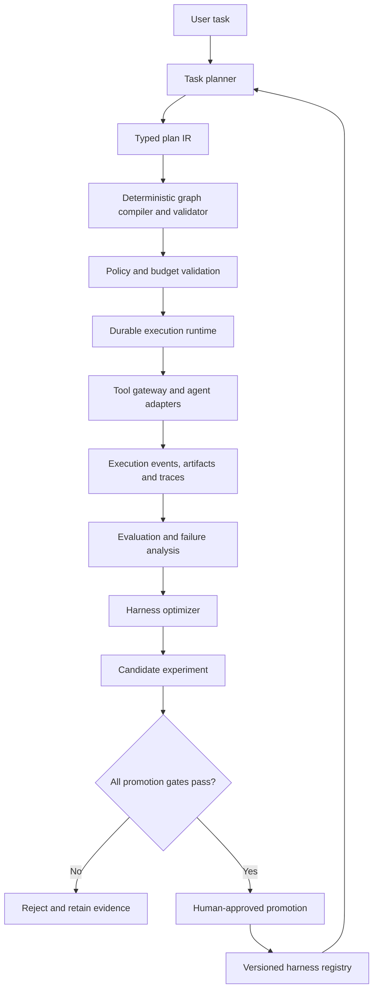

# ATLAS — Adaptive Agent Execution & Reliability Engine

> **Codex implementation brief**  
> Status: Proposed architecture / implementation plan  
> Initial target: Python 3.12+, local-first developer experience, production-minded foundations  
> Core thesis: Build an agent execution runtime that can compile task-specific workflows, execute them under deterministic policy controls, reproduce failures, and improve its mutable harness configuration only when experiments provide sufficient evidence.

---

## 0. Instructions to Codex

Treat this document as the product and architecture brief. Do not attempt to implement the entire system in one pass.

1. First inspect the repository and report its current state. Preserve useful existing code; do not overwrite files blindly.
2. Convert this plan into an actionable backlog with milestones, dependencies, and acceptance criteria.
3. Propose an architecture decision record (ADR) for any material deviation from this plan.
4. Implement one vertical slice at a time. Each slice must include tests, documentation, and a runnable example.
5. Prefer simple, explicit abstractions over speculative frameworks. Do not build a generic agent framework or a large plugin marketplace.
6. Keep provider/model integrations behind interfaces. The core runtime must work with deterministic fake agents and fake tools without paid API credentials.
7. Never let an LLM-generated plan or optimizer patch bypass deterministic validation, authorization, resource limits, or approval gates.
8. Do not claim replay is deterministic if model calls or external side effects are being re-executed. Replay should use recorded inputs and outputs by default.
9. Keep `ATLAS_CONTEXT.md` current with architecture decisions, implemented features, known limitations, and next steps.
10. Before each milestone is considered complete, run the relevant test suite and provide the exact commands and results.

Start by producing:
- `docs/implementation-roadmap.md`
- `docs/architecture.md`
- `docs/threat-model.md`
- `docs/adr/0001-initial-architecture.md`
- an initial repository tree

Then begin Milestone 0 and Milestone 1 only. Do not jump ahead to the optimizer before the runtime, policy enforcement, event model, and evaluation baseline are working.

---

## 1. Product definition

### 1.1 What Atlas is

Atlas is an **adaptive agent execution and reliability control plane**. It accepts a task, compiles it into a validated execution graph, runs that graph through a durable runtime, records evidence about execution, and can later propose constrained changes to the agent harness.

A harness includes mutable operating components such as:
- task-specific system/developer instructions;
- skill selection and ordering;
- tool selection and tool-use guidance;
- agent role configuration;
- workflow topology and execution strategy;
- model choice and bounded inference settings.

Atlas must distinguish these mutable components from immutable or tightly controlled safety controls.

### 1.2 What Atlas is not

Atlas is not:
- another chat UI with multiple agents;
- a general-purpose replacement for LangGraph, LangSmith, Langfuse, or OpenTelemetry;
- an unrestricted autonomous coding agent;
- a system that lets an LLM rewrite its own permissions;
- an optimizer that promotes changes based on one successful example.

Use existing libraries where they provide clear value. Atlas's original engineering contribution should be the integration of dynamic workflow compilation, policy-constrained execution, evidence capture/replay, and evidence-gated harness evolution.

### 1.3 Primary differentiator

**Evidence-Gated Self-Improvement:** Atlas may propose changes to its mutable harness, but it cannot promote them unless they pass repeatable evaluations and deterministic safety/policy gates against a fixed baseline.

A candidate improvement should answer:
1. What behaviour is expected to change?
2. What evidence suggests the current harness is weak?
3. Which exact configuration fields are changing?
4. Which benchmark cases were used?
5. Did task quality improve or remain non-inferior?
6. What happened to cost, latency, and policy violations?
7. Can the candidate be rolled back?

---

## 2. Target use case and demo

Use a constrained software-maintenance workflow as the primary reference workload:

> “Investigate the authentication bug in this repository, implement a fix, add regression tests, run the test suite, and prepare a reviewable patch summary.”

Atlas should compile a task-specific DAG containing some combination of:
1. Planner / task decomposer.
2. Repository analyst.
3. Implementer.
4. Test executor.
5. Independent reviewer / verifier.
6. Final report generator.

The graph must not be fixed in code. A planner may propose a different valid graph depending on task complexity, but a deterministic compiler validates and freezes the graph version before execution.

A useful failure demonstration:
- Baseline coding agent repeatedly misses a required integration test.
- Atlas records the failed execution and evidence.
- Optimizer proposes adding a verification step or changing a skill/tool instruction.
- Candidate and baseline are run on the same benchmark set and controlled environment.
- Candidate is promoted only if it passes quality, security, cost, and latency gates.

For the initial demo, use a small local benchmark repository with seeded bugs and tests. Do not make SWE-bench-scale infrastructure a prerequisite for the MVP.

---

## 3. Core architecture

### 3.1 High-level flow



### 3.2 Logical components

**A. Task planner**
- Converts a natural-language task and supplied context into a typed plan proposal.
- Can use an LLM provider, but must also have a deterministic fixture planner for tests.
- Its output is untrusted input. Never execute it directly.

**B. Typed Plan IR**
- A versioned, serializable intermediate representation for the proposed execution graph.
- Contains nodes, dependencies, inputs/outputs, agent/tool references, budgets, and policy requirements.
- Prefer Pydantic models and JSON Schema validation.

**C. Graph compiler and validator**
- Validates graph structure: unique IDs, valid references, acyclic dependencies, valid joins, type-compatible edges, reachable terminal node, and bounded graph size/depth.
- Resolves agent and tool capabilities against a server-side registry.
- Freezes the accepted plan as an immutable `plan_version` for the run.
- Rejects unknown node types, arbitrary executable code, arbitrary import paths, and undeclared tools.

**D. Policy and budget engine**
- Deterministic enforcement point for every tool invocation and sensitive operation.
- Deny by default. Policies are supplied by the application/operator, not generated by the LLM.
- Enforce tool allowlists, file/workspace scope, network rules, approval requirements, timeouts, concurrency, token/cost budgets, and maximum retries.
- A harness optimizer must never be able to edit or weaken policy definitions.
- Start with a small Python policy engine and explicit policy objects; keep an adapter seam for OPA or another policy engine later.

**E. Durable execution runtime**
- Executes validated DAG nodes with bounded concurrency.
- Supports state transitions, checkpoints, cancellation, timeout, retry, and recovery.
- Retries only operations known to be safe or idempotent. Side-effecting tools require idempotency keys or explicit human approval.
- Persist node state and outputs before scheduling dependent nodes.
- Use an execution lease/claim mechanism if multiple workers are introduced.

**F. Tool gateway**
- All tools are called through one gateway; agents never receive direct unrestricted access to the host.
- Gateway performs authorization, argument validation, budget checks, timeout enforcement, audit logging, and result normalization.
- Implement safe built-in tools first: read-only workspace listing/read, controlled test runner, and fixture tools.
- No arbitrary shell command execution on the host. Any command execution must happen in an isolated, disposable workspace/container with restricted mounts, resource limits, and an explicit command policy.

**G. Observability and evidence store**
- Capture run, plan, node, agent, and tool events with correlation IDs.
- Capture structured inputs/outputs, timestamps, status, retry count, token/cost estimates, latency, and artifact references.
- Integrate OpenTelemetry for traces and metrics rather than reinventing a tracing protocol.
- Persist business-level execution events in PostgreSQL; do not rely on traces as the only durable audit record.

**H. Replay engine**
- Reconstruct an execution using the saved plan, configuration, prompt versions, tool arguments, and recorded tool outputs.
- Default replay mode uses recorded tool responses and does not repeat external side effects.
- Mark any newly executed model call or external tool call explicitly as a non-deterministic replay mode.
- Provide divergence reports between original and replayed executions.

**I. Evaluation and optimizer**
- Compare a baseline harness and candidate harness on a fixed, versioned evaluation suite.
- Optimizer can propose only allowlisted mutable configuration patches.
- Run candidate experiments in isolated workspaces and under the same benchmark and budget constraints as the baseline.
- No automatic production promotion in the MVP; require explicit operator approval.

---

## 4. Important design contracts

### 4.1 Plan IR (initial sketch)

A plan should represent:
- `plan_id`, `plan_version`, `task_id`;
- `nodes[]`: `node_id`, `kind`, `name`, `agent_ref` or `tool_ref`, `input_mapping`, `output_schema`, `depends_on`, `timeout_seconds`, `retry_policy`, `resource_budget`, `required_capabilities`;
- `edges[]`: source, target, optional condition;
- global limits: maximum nodes, maximum depth, maximum parallelism, total deadline, total token/cost budget;
- `metadata`: planner version, model/provider, prompt version, creation time.

Initial node kinds:
- `agent`: invoke a registered agent profile;
- `tool`: invoke a registered tool through the tool gateway;
- `condition`: evaluate a deterministic, typed condition;
- `join`: wait for declared dependencies and combine their outputs;
- `human_approval`: pause for an explicit approval decision;
- `output`: collect and validate final output.

Do not support arbitrary Python functions or arbitrary code embedded in the plan.

### 4.2 Agent contract

Every registered agent profile must declare:
- stable `agent_id` and version;
- input and output schemas;
- allowed tool IDs/capabilities;
- model/provider configuration reference (never credentials);
- timeout and retry policy;
- resource budget defaults;
- prompt/skill configuration version;
- whether human approval is required for specified actions.

Agent adapters should be replaceable. Start with a fake deterministic adapter and one real provider adapter behind a common protocol.

### 4.3 Tool contract

Every tool must declare:
- stable ID and version;
- JSON input/output schemas;
- capability and risk class;
- whether it is read-only, idempotent, or side-effecting;
- timeout and resource limit;
- allowed workspace/network scope;
- approval requirement;
- audit metadata.

### 4.4 Harness patch contract

An optimizer patch is a typed diff, not arbitrary text or code. Initial allowlisted fields:
- task-specific instruction template version;
- skill IDs and ordering;
- agent role configuration fields;
- tool-use guidance and tool preference ordering among already-authorized tools;
- workflow topology choices within the allowed node/capability set;
- inference budget allocation within operator-defined ceilings.

Immutable / prohibited fields:
- security policies and authorization rules;
- tool permission allowlists;
- credential references, secrets, environment variables;
- sandbox boundaries and filesystem/network restrictions;
- human approval requirements;
- data-retention and privacy settings;
- global maximum resource ceilings;
- evaluator definitions and benchmark acceptance thresholds.

Any attempt to change a prohibited field must be rejected and audited.

---

## 5. Technology choices

Use these as defaults, not dogma. Record alternatives in ADRs before changing them.

| Layer | Initial choice | Rationale |
|---|---|---|
| Language | Python 3.12+ | Strong ecosystem for agent runtimes and evaluation |
| API | FastAPI | Typed API and easy local development |
| Schemas | Pydantic v2 | Typed contracts and JSON Schema generation |
| Runtime | asyncio + custom DAG executor | Understand and own the core execution semantics |
| Persistence | PostgreSQL | Durable runs, nodes, events, experiments, and harness versions |
| DB layer | SQLAlchemy 2 + Alembic | Explicit persistence and migrations |
| Cache/queue | Redis, later milestone | Do not add until worker coordination requires it |
| Tracing | OpenTelemetry | Standard traces/metrics export |
| Isolation | Docker containers | Disposable workspace for command/test execution |
| Testing | pytest, pytest-asyncio, hypothesis where useful | Unit, integration, property and failure-injection tests |
| Packaging | pyproject.toml, uv | Reproducible development environment |
| Local deployment | Docker Compose | One-command local environment |
| CLI | Typer | Run, inspect, replay and evaluate workflows |

Do not make LangGraph a hard dependency of the core engine. Add a LangGraph adapter only after the core plan/runtime contracts are stable. Atlas should be able to execute its own typed DAG without requiring an orchestration framework.

---

## 6. Proposed repository layout

```text
atlas/
├── AGENTS.md
├── ATLAS_CONTEXT.md
├── README.md
├── pyproject.toml
├── uv.lock
├── .env.example
├── docker-compose.yml
├── Dockerfile
├── Makefile
├── src/atlas/
│   ├── api/
│   │   ├── app.py
│   │   └── routes/
│   ├── cli/
│   ├── core/
│   │   ├── ids.py
│   │   ├── errors.py
│   │   ├── events.py
│   │   └── config.py
│   ├── plans/
│   │   ├── ir.py
│   │   ├── compiler.py
│   │   ├── validators.py
│   │   └── planner.py
│   ├── runtime/
│   │   ├── engine.py
│   │   ├── scheduler.py
│   │   ├── state_machine.py
│   │   ├── checkpoints.py
│   │   └── recovery.py
│   ├── agents/
│   │   ├── protocol.py
│   │   ├── registry.py
│   │   └── adapters/
│   ├── tools/
│   │   ├── protocol.py
│   │   ├── gateway.py
│   │   ├── registry.py
│   │   └── builtin/
│   ├── policy/
│   │   ├── engine.py
│   │   ├── models.py
│   │   └── defaults.py
│   ├── persistence/
│   │   ├── models.py
│   │   ├── repositories/
│   │   └── migrations/
│   ├── telemetry/
│   ├── replay/
│   ├── evaluation/
│   ├── optimizer/
│   └── harness/
├── examples/
│   ├── hello_agent/
│   └── repo_maintenance/
├── benchmarks/
│   ├── tasks/
│   ├── fixtures/
│   └── reports/
├── tests/
│   ├── unit/
│   ├── integration/
│   ├── security/
│   └── e2e/
└── docs/
    ├── architecture.md
    ├── implementation-roadmap.md
    ├── threat-model.md
    ├── api.md
    ├── evaluation-methodology.md
    └── adr/
```

The exact tree may evolve. Keep modules cohesive; do not create empty packages for every future idea.

---

## 7. Persistence model (initial)

Use migrations and explicit relationships. Suggested tables/entities:

- `tasks`: user task, metadata, created time, requested scope.
- `plans`: immutable serialized plan IR, version, validation result, planner provenance.
- `runs`: task/plan reference, status, start/end, deadline, budget, final result reference.
- `nodes`: node execution state, attempts, input/output references, timings, error classification.
- `execution_events`: append-only business events with sequence number, run ID, node ID, event type and structured payload.
- `tool_invocations`: tool ID/version, validated argument hash, result/artifact reference, risk class, policy decision, timing.
- `artifacts`: content-addressed metadata and storage URI; never store arbitrary large files directly in event rows.
- `harness_configs`: immutable versioned harness configuration snapshots.
- `experiments`: baseline/candidate IDs, dataset version, environment, status, metrics and decision.
- `evaluation_cases` and `evaluation_results`: versioned cases and per-run results.
- `approvals`: requested action, requested-by, decision, approver, timestamp, expiry.

Use append-only events for auditability. Mutable run/node status can be materialized from events or updated transactionally while retaining the underlying event history.

---

## 8. API and CLI surface

Initial API endpoints (version all routes):

- `POST /v1/runs` — submit a task and optional constraints.
- `GET /v1/runs/{run_id}` — retrieve run status and summary.
- `GET /v1/runs/{run_id}/events` — retrieve ordered execution events.
- `GET /v1/runs/{run_id}/nodes` — inspect node state and attempts.
- `POST /v1/runs/{run_id}/cancel` — request cancellation.
- `POST /v1/runs/{run_id}/replay` — create a replay from a recorded run.
- `GET /v1/plans/{plan_id}` — retrieve validated plan.
- `POST /v1/evaluations` — launch an evaluation suite.
- `GET /v1/experiments/{experiment_id}` — inspect baseline/candidate experiment.
- `POST /v1/experiments/{experiment_id}/approve` — explicit promotion approval, when eligible.

Initial CLI commands:

```bash
atlas run --task-file examples/repo_maintenance/task.md
atlas inspect run <run-id>
atlas events <run-id>
atlas replay <run-id> --mode recorded-tools
atlas evaluate --suite benchmarks/suites/smoke.yaml
atlas optimize --baseline <harness-version> --suite <suite-id> --dry-run
```

The CLI must work against the local Docker Compose environment and should also support a deterministic in-memory test mode.

---

## 9. Milestone plan and acceptance criteria

### Milestone 0 — Architecture and project skeleton

Deliver:
- repository skeleton, `pyproject.toml`, formatter/linter/type-checker configuration;
- initial architecture, threat model, roadmap and ADR;
- configuration loading and structured logging;
- CI workflow for lint, type checks and tests;
- deterministic fake model and tool interfaces.

Acceptance:
- fresh clone can install dependencies and run tests using documented commands;
- no secrets are committed;
- architecture decisions and non-goals are documented.

### Milestone 1 — Typed plan IR and graph compiler

Deliver:
- Pydantic plan/node/edge models;
- graph compiler and structural validator;
- registry resolution for agent and tool references;
- deterministic fixture planner;
- plan serialization and version/hash generation.

Acceptance tests:
- reject cycles, duplicate IDs, dangling edges, unknown nodes/tools, invalid schemas, unreachable outputs, excessive graph size/depth, and unbounded parallelism;
- accept valid sequential, parallel/fan-out, conditional, join, and human-approval graphs;
- compiled plan is immutable and has a stable content hash.

### Milestone 2 — Durable execution runtime

Deliver:
- node state machine and DAG scheduler;
- bounded concurrency;
- run/node persistence and checkpoints;
- timeout, cancellation, retry policy and recovery;
- a working multi-node example with fake agents/tools.

Acceptance tests:
- independent nodes execute concurrently up to the configured limit;
- dependent nodes never start before dependencies succeed;
- failure blocks or routes downstream work according to explicit policy;
- process restart recovers eligible work without duplicating completed side effects;
- cancellation and deadlines are respected;
- retry does not occur for non-idempotent tools without an idempotency strategy.

### Milestone 3 — Policy enforcement and secure tool gateway

Deliver:
- centralized tool gateway;
- deny-by-default tool permissions;
- capability and risk classification;
- workspace-scoped file access;
- resource budgets and approval checkpoints;
- audit events for every policy decision;
- isolated command/test runner prototype.

Acceptance tests:
- an agent cannot call a tool absent from its allowlist;
- invalid tool arguments are rejected before invocation;
- traversal outside the workspace is blocked;
- secrets are redacted from logs and traces;
- side-effecting actions pause for required approval;
- optimizer/plan inputs cannot alter policy ceilings or grant permissions.

### Milestone 4 — Observability, artifacts and replay

Deliver:
- OpenTelemetry trace integration;
- structured run/node/tool events;
- artifact storage abstraction;
- trace/event inspection CLI;
- recorded-tool replay and divergence report.

Acceptance tests:
- one run can be followed end-to-end by a correlation/run ID;
- each tool call records policy decision, validated input hash and result reference;
- replay uses recorded outputs by default and performs no external side effects;
- replay clearly marks any non-recorded/model re-execution;
- sensitive content is redacted according to configured policy.

### Milestone 5 — Evaluation and benchmark baseline

Deliver:
- versioned evaluation suite and task fixtures;
- deterministic evaluators for structural requirements and test outcomes;
- configurable rubric evaluator for qualitative outputs (with evaluator version/model recorded);
- baseline reports for task success, quality, cost, latency, retries and safety violations;
- paired comparison runner.

Acceptance tests:
- identical configurations can be compared on the same cases and environment;
- results include sample count and uncertainty/variance where applicable;
- no candidate can pass if it violates a hard safety gate;
- benchmark inputs, evaluator versions and run metadata are retained.

### Milestone 6 — Evidence-gated harness optimizer

Deliver:
- failure/weakness classification from recorded evidence;
- optimizer proposal schema and allowlisted patch validator;
- candidate harness generation;
- isolated baseline-versus-candidate experiments;
- persistent experience records with provenance, task scope, confidence and expiry;
- manual approval workflow for candidate promotion;
- rollback to prior harness version.

MVP optimizer scope should be narrow. Start with changes to:
1. task-specific instruction variants;
2. skill selection/order among pre-approved skills;
3. tool preference guidance among already-authorized tools;
4. bounded verification-step/topology choices.

Acceptance tests:
- optimizer cannot modify immutable policy fields;
- every candidate patch has a machine-readable diff and rationale;
- baseline and candidate receive the same benchmark cases and comparable budgets;
- candidate promotion requires all hard gates and an explicit approval;
- regression causes candidate rejection;
- every promoted version is reversible and traceable to its experiment.

### Milestone 7 — Developer experience and public release

Deliver:
- polished CLI and a minimal read-only web dashboard;
- Docker Compose quick start;
- two end-to-end demos: dynamic task graph and evidence-gated improvement;
- architecture and sequence diagrams;
- threat model, benchmark methodology and limitations;
- GitHub Actions CI and tagged release process;
- short demo recording and reproducible benchmark report.

Acceptance:
- a new developer can run the demo from a clean checkout using the README;
- demo works without paid credentials using fake providers;
- optional real provider setup is documented separately;
- benchmark claims are reproducible and clearly distinguish measured results from illustrative examples.

---

## 10. Evaluation methodology

Do not optimize for a single aggregate score. Track at least:

| Metric | Definition |
|---|---|
| Task success | Fraction of benchmark tasks meeting their explicit acceptance criteria |
| Verified quality | Fraction passing deterministic tests/checks plus separately reported rubric results |
| Cost per successful task | Total model/tool cost divided by successful tasks |
| Latency | Median and p95 end-to-end duration |
| Tool efficiency | Number of tool invocations and unnecessary/repeated calls |
| Recovery rate | Fraction of injected transient failures recovered correctly |
| Replay fidelity | Fraction of recorded-tool replays reproducing the original state/result under the defined replay contract |
| Policy violations | Count of denied or attempted prohibited actions; successful prohibited actions must be zero |
| Regression rate | Fraction of previously passing cases that fail with a candidate harness |

Experiment rules:
- use a fixed, versioned test suite;
- compare baseline and candidate on the same cases;
- run multiple trials for stochastic model behaviour;
- report sample count, variance/confidence intervals where meaningful;
- separate deterministic checks from LLM-graded evaluations;
- do not treat an LLM judge as ground truth;
- enforce quality non-inferiority and zero-tolerance hard safety gates;
- set explicit cost and latency ceilings;
- never promote based on one anecdotal success.

A reasonable early promotion rule is: zero hard policy violations, all mandatory regression tests pass, no statistically or practically meaningful quality regression, and at least one predeclared improvement (for example, fewer tool calls or lower cost) without exceeding latency/cost constraints. Define exact thresholds in the benchmark configuration, not in optimizer-generated text.

---

## 11. Security and reliability requirements

Threat model at minimum:
- prompt injection from user input, repository files, web pages, tool outputs and retrieved content;
- tool misuse and confused-deputy behaviour;
- path traversal and workspace escape;
- command injection and malicious dependencies;
- secret exfiltration through logs, tool outputs or generated artifacts;
- plan graph denial-of-service through excessive nodes, depth, loops or fan-out;
- retry storms and duplicate side effects;
- optimizer attempting privilege escalation or evaluator manipulation;
- benchmark contamination and data leakage between candidate runs;
- stale or overgeneralized learned experiences;
- unsafe approval reuse or spoofed approval identity.

Required controls:
- treat all model-generated content and tool-returned content as untrusted;
- validate all plans and tool arguments with typed schemas;
- enforce permissions in code at the tool gateway, not in prompts;
- deny by default;
- isolate command execution and candidate experiments;
- use least privilege and scoped credentials;
- redact secrets and sensitive values;
- enforce maximum graph size, depth, concurrency, wall-clock time and cost;
- use idempotency keys for side effects;
- keep an append-only audit trail;
- separate optimizer credentials/permissions from runtime policy administration;
- require human approval for high-impact actions and promotion;
- support cancellation and rollback.

---

## 12. Scope boundaries: MVP vs later research

### MVP (must ship)
- typed DAG plan and validator;
- durable async execution for local workloads;
- central tool gateway and deterministic policy enforcement;
- checkpoints, retries, cancellation and recovery;
- structured events, traces and recorded-tool replay;
- benchmark runner and baseline metrics;
- constrained harness patch proposal and evaluation;
- human-approved promotion and rollback;
- local Docker Compose deployment and CLI.

### Later extensions (do not block MVP)
- distributed multi-worker scheduling and Redis queue;
- Kubernetes deployment and autoscaling;
- full visual graph editor;
- broad MCP server marketplace;
- autonomous optimizer budget allocation;
- cross-project/global memory sharing;
- support for arbitrary third-party harness formats;
- sophisticated online learning or reinforcement learning;
- automatic production promotion.

---

## 13. Definition of done for the portfolio project

Atlas is portfolio-ready only when the repository demonstrates all of the following:

1. **Working product:** a user can submit a task and see a dynamically compiled, validated graph execute.
2. **Real engineering:** durable state, checkpoints, concurrency limits, cancellation, retries and recovery work under tests.
3. **Security:** every tool call passes through deterministic authorization and a constrained execution boundary.
4. **Debuggability:** traces, event history, artifacts and a recorded-tool replay are available for a run.
5. **Evidence:** a fixed benchmark compares baseline and candidate harness versions with reproducible metrics.
6. **Safe adaptation:** the optimizer proposes a constrained change, evaluates it, rejects regressions, and requires approval before promotion.
7. **Communication:** README, architecture, threat model, ADRs, API docs, benchmark methodology and demo explain the system honestly.

The public demo should show one baseline failure, the evidence captured, a specific candidate harness change, a controlled experiment, and the promotion/rejection decision. Avoid presenting fabricated benchmark numbers.

---

## 14. First task for Codex

Begin with repository inspection and Milestone 0. Then implement a smallest useful vertical slice for Milestone 1:

- define Pydantic models for `Plan`, `Node`, `Edge`, `AgentProfile`, and `ToolDefinition`;
- implement a graph validator that rejects cycles, dangling references, duplicate IDs, invalid node kinds, and excessive graph size/depth;
- create one valid sequential plan and one fan-out/join plan fixture;
- write unit tests for valid and invalid plans;
- serialize a validated plan and compute a stable content hash;
- expose a small CLI command that validates a plan JSON file;
- document how to run the tests and validate the example.

Do not integrate a real LLM provider in this first slice. Prove the contracts and compiler are correct before adding model variability.

**Expected first result:** a clean, tested plan compiler that converts untrusted plan JSON into a validated immutable execution plan, or rejects it with actionable errors.
