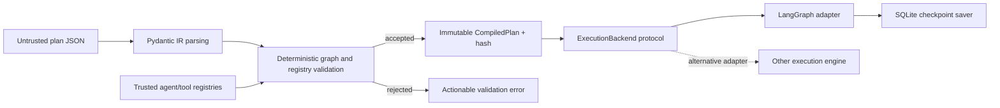
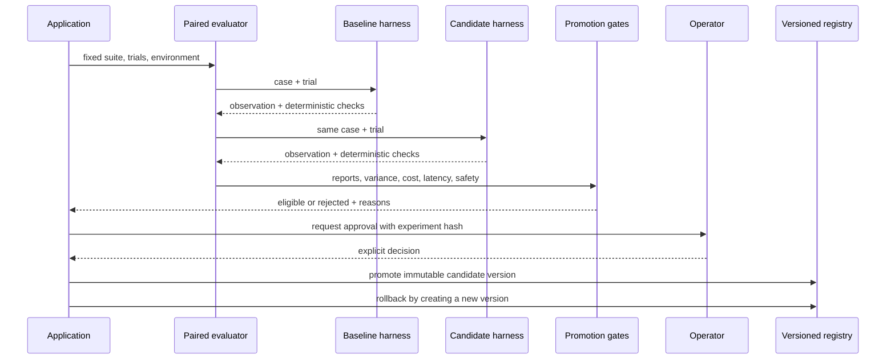

# ATLAS architecture

## Current implementation boundary

The current code implements a narrow trust boundary: untrusted serialized plan input is parsed into immutable Pydantic models and passed through a deterministic compiler before becoming `CompiledPlan`. The compiler checks graph integrity and bounds, resolves agent/tool references against registries supplied by trusted application code, canonicalizes the IR, and computes a SHA-256 content fingerprint. The framework-neutral `ExecutionBackend` protocol accepts only a `CompiledPlan`; `LangGraphExecutionBackend` implements it by compiling the frozen DAG to LangGraph nodes/edges and checkpointing state to SQLite.



## Target system shape

The intended flow is: task request → planner proposal → typed plan compiler → policy/budget validation → durable DAG runtime → centralized tool gateway and agent adapters → append-only business events/artifacts → replay/evaluation → constrained optimizer experiment → human-approved harness promotion. The compiler is a security boundary, but not a substitute for runtime authorization: every operation must be checked again at the tool gateway.

### Components and ownership

- **Plan IR and compiler (implemented):** accepts serialized data only; no code/import path execution. Registry data comes from trusted application initialization.
- **Agent/tool adapters (contract seam implemented):** provider-independent protocols and deterministic fixtures. Credentials and provider SDKs are out of core contracts.
- **Execution backend (Milestone 2):** a framework-neutral async execution contract with a LangGraph adapter. It translates graph dependencies to LangGraph barriers, bounds concurrency, records node outcomes/attempts, validates adapter schemas, applies deadlines/retries, and uses the SQLite checkpointer for local recovery.
- **ReAct loop (agent node):** individual agent nodes iterate over typed `act`/`final` decisions. The runner exposes only the intersection of profile-allowlisted and operator-authorized tools, sends each call through the centralized gateway, executes calls sequentially, and returns each observation on the agent's next turn. LangGraph continues to schedule the outer DAG and is not responsible for the inner reasoning loop.
- **Policy/tool gateway (Milestone 3):** every DAG and ReAct tool invocation enters a per-run `ToolGatewaySession`. Immutable operator `ToolPolicy` is separate from Plan IR, denies by default, and applies allowlists, capability/network grants, schema and byte validation, workspace containment, per-run call limits, concurrency, timeouts, approvals, and audit decisions. SQLite audit records contain input/output hashes and safe metadata, not raw values. `SecretRedactor` protects structured traces and JSON log messages.
- **Secure built-ins (Milestone 3):** workspace reads are root-scoped; test commands use exact configured argv in a restricted Docker container (network off, read-only mounts/root, dropped capabilities, no-new-privileges, process/memory/CPU bounds, timeout and output cap).
- **Events, artifacts, and replay (Milestone 4):** `RunEventStore` and `ArtifactStore` protocols decouple storage from the backend. The local implementation uses SQLite append-only events and SHA-256-addressed artifacts. Run, node, and tool events share run ID and plan hash; tool events reference argument/result artifacts while the Phase 3 audit remains payload-free. OpenTelemetry spans wrap runs, nodes, and tool calls. Recorded-tool replay restores source inputs and exchanges without invoking tool adapters; agent adapters are re-executed and reported as nondeterministic.
- **Evaluation (Milestone 5):** versioned suites/cases run through a provider-neutral evaluator contract. Deterministic output/node/test checks are separate from an optional versioned rubric adapter. Paired comparisons report success, verified quality, uncertainty, cost, latency, retries, tool efficiency, and hard safety violations; suite inputs and reports are persisted.
- **Harness optimizer (Milestone 6):** strict typed patches can change only instruction variant, pre-approved skills, already-authorized tool preferences, verification-step selection, and inference tokens below operator ceilings. Baseline and candidate use the same suite/environment; `IsolatedEvaluationRunner` can provide a fresh copied workspace per harness/case/trial. Hard gates and a separate hash-bound approval precede versioned promotion. Rollback creates a new version based on an earlier snapshot.
- **Developer experience (Milestone 7):** stdlib CLI and read-only local dashboard, Docker Compose demo, fixture-only benchmark/improvement demos, CI and tag-triggered GitHub release artifacts.
- **Persistent API (Milestone 8):** FastAPI lifespan constructs trusted registries, compiler, event store and LangGraph backend. Plans are compiled before `202` admission and executed as bounded in-process asyncio tasks; admission has a total pending/active cap. Status/events are read from SQLite run events; cancellation targets the local task. Authentication is an injectable interface and disabled by default for the local prototype.
- **Gemini provider (Milestone 9):** optional `GeminiAgent` implements the existing `Agent` protocol using Google's async GenAI SDK. It returns typed turns and manual function-call requests; the ReAct runner remains responsible for all tool execution. Provider-neutral decision telemetry records model, latency, token usage, and optionally estimated cost.
- **Task intake vertical slice:** `Planner` and `WorkflowProposal` in `plans/planner.py` define a provider-neutral, closed plan contract. `GeminiPlanner` requests JSON-schema structured output. `AgentTemplateRegistry` exposes only operator-defined role IDs; `AgentFactory` clones immutable trusted profiles with per-node IDs and creates a fresh adapter for each node. `POST /v1/tasks` validates the proposal, maps it into normal Plan IR, compiles it with `PlanCompiler`, then admits it through `RunService`. The per-run executor constructs a LangGraph backend with only the instantiated agents and preconfigured tools/policy, and closes adapters after success, exception, or cancellation. The response includes the compiled Plan for inspection. This does not yet aggregate semantic agent results or invoke evaluation/optimization.

## Key data contracts

The current Plan contains versioned IDs, nodes, edges, structural limits, and metadata. Nodes use a closed `NodeKind` enumeration and can reference only registered agents/tools; requested capabilities must be declared by the referenced profile/definition. `CompiledPlan` holds a deeply frozen Plan, canonical JSON, content hash, and topological order. Pydantic models forbid unknown fields. JSON Schema documents are checked with Draft 2020-12 schema validation. The backend protocol and `ExecutionResult` do not expose LangGraph types, and LangGraph is an optional package extra.

For the current backend, adapter inputs have a stable envelope: `run` contains the initial invocation input, `dependencies` maps parent node IDs to their outputs, and `mapped` contains the node's literal `input_mapping`. Agent adapters receive that object as JSON in `AgentRequest.input_json`; tool adapters receive it as a dictionary. Join/output nodes return the same envelope. This convention is part of the adapter's current contract and may later be versioned independently of Plan IR.

Agent adapters return either a legacy string final response or a structured `AgentTurn`. `AgentTurn.action` is `act` with one or more typed tool calls, or `final` with an output. `AgentProfile.max_iterations` configures the inner loop (also capped by backend limits); the enclosing plan node's `timeout_seconds` bounds the whole agent loop. Backend configuration caps calls per iteration and per agent. Tool failures and rejected calls become `AgentObservation` values supplied on the next request. `ExecutionResult.agent_traces` and the checkpoint state record ordered decisions, concise action summaries, tool arguments/results, observations, errors, and final outcomes with run/node/agent version IDs. The trace schema has no private chain-of-thought field, and raw model text is never recorded as a reasoning trace.

Provider adapters attach optional `AgentTelemetry` to a decision. It contains provider/model IDs, latency, available input/output token counts, and an estimated cost only when token rates are explicitly configured. Gemini reads credentials from environment or a configured secret file and sanitizes SDK failures. Its function declarations are manual schemas, not executable SDK callbacks; Atlas maps function names to trusted tool IDs and invokes them through the gateway. Other providers can implement the same protocol without changing compiler or LangGraph orchestration.

Canonical hashes cover the complete serialized plan, including metadata. They identify content; they do not authenticate origin or prove semantic equivalence. Registry definitions are resolved during compilation but currently are not included in the content hash, so a future persisted plan must separately pin registry versions in provenance.

## Execution invariants

1. Only a validated, frozen plan version can enter an execution backend.
2. A planner or optimizer never supplies executable code or grants permissions.
3. Authorization is checked at execution time for each tool invocation.
4. Persist node outputs/events before scheduling dependent nodes.
5. Retry only safe/idempotent operations; use idempotency keys or approval for side effects.
6. Recorded replay uses recorded outputs and does not repeat side effects by default.
7. Hard safety gates and policy definitions are operator-controlled and immutable to optimization.
8. A tool adapter is invoked only after the gateway has durably recorded an allow decision.
9. Side-effecting/destructive tools require action-hash-bound, unexpired approval; absent approval infrastructure denies the call.

## Failure handling and observability direction

Validation failures are deterministic and fail closed with specific messages. Milestone 2 saves node state, results, and attempts as LangGraph checkpoints in a local SQLite database. Dependents wait at graph barriers; failed dependencies are marked blocked. A cancelled process can resume a checkpointed run by using the same run ID and `resume=True`; the currently executing node may run again, so adapters must be cooperative on cancellation and external effects must be idempotent. This checkpoint is not a durable business audit event store. Distributed scheduling, Redis, worker leases, and Postgres business records remain future work.

The gateway audit database is a separate append-only API and local SQLite file. Its records provide decision/outcome evidence but are not tamper-proof against a host administrator and do not implement distributed audit replication or retention. Run events and content-addressed artifacts use separate local stores and expose inspection/replay interfaces. Artifact files are owner-only but unencrypted; deployments must protect and retain them appropriately. PostgreSQL/object storage and multi-worker ordering are future adapters.

The Milestone 8 HTTP API is single-process. Accepted plan/input requests are stored as artifacts referenced by `run.queued` events. Its task registry and concurrency semaphore are in memory; do not run multiple Uvicorn workers or replicas. Restart does not automatically resume queued/running tasks, even though events, request artifacts, and LangGraph checkpoints persist. Requests cannot install tools or grant permissions: application startup owns both registries and the `ToolPolicy` passed to the backend.

Task intake is opt-in at application composition time: inject a `Planner` and trusted `AgentTemplateRegistry` into `create_app`. The stock `atlas.api.app:app` remains plan-submission-only. A planner request body contains only task text and context; trusted role descriptions and hard limits are added by the server. Planner output is constrained to node IDs, registered role IDs, task descriptions, dependency edges, depth, and parallelism. The compiler checks DAG structure and resolves generated per-node agent IDs. `WorkflowProposal` forbids extra fields, so tools, capabilities, credentials, and policies cannot be expressed by the planner contract. Task context and planner-produced task descriptions are untrusted input to model agents and must not be treated as instructions that override tool policy.



## Current repository tree

```text
.
├── AGENTS.md
├── ATLAS_CONTEXT.md
├── ATLAS_IMPLEMENTATION_PLAN.md
├── README.md
├── pyproject.toml
├── docs/
│   ├── adr/0001-initial-architecture.md
│   ├── adr/0002-langgraph-adapter.md
│   ├── adr/0003-react-within-agent-nodes.md
│   ├── adr/0004-centralized-tool-gateway.md
│   ├── adr/0005-local-events-artifacts-and-recorded-tool-replay.md
│   ├── adr/0006-versioned-paired-evaluation.md
│   ├── adr/0007-constrained-harness-optimization.md
│   ├── adr/0008-local-dx-and-read-only-dashboard.md
│   ├── adr/0009-single-process-fastapi-service.md
│   └── adr/0010-gemini-agent-adapter.md
│   ├── architecture.md
│   ├── demo-script.md
│   ├── evaluation-methodology.md
│   ├── implementation-roadmap.md
│   ├── limitations.md
│   ├── provider-adapters.md
│   ├── release-process.md
│   └── threat-model.md
├── benchmarks/reports/README.md
├── docker-compose.yml
├── Dockerfile
├── examples/plans/
│   ├── fanout_join.json
│   └── sequential.json
├── examples/runtime_fake.py
├── examples/react_fake.py
├── examples/evidence_gated_improvement.py
├── src/atlas/
│   ├── agents.py
│   ├── api/
│   ├── builtin_tools.py
│   ├── cli.py
│   ├── config.py
│   ├── evaluation.py
│   ├── observability.py
│   ├── optimizer.py
│   ├── providers/gemini.py
│   ├── plans/{__init__.py,compiler.py,ir.py,planner.py}
│   ├── react.py
│   └── runtime/{__init__.py,backend.py,langgraph_backend.py}
│   └── tools.py
└── tests/
    ├── test_cli_dashboard.py
    ├── test_evaluation.py
    ├── test_foundations.py
    ├── test_langgraph_backend.py
    ├── test_observability.py
    ├── test_optimizer.py
    ├── test_plan_compiler.py
    ├── test_react.py
    └── test_tool_gateway.py
```
